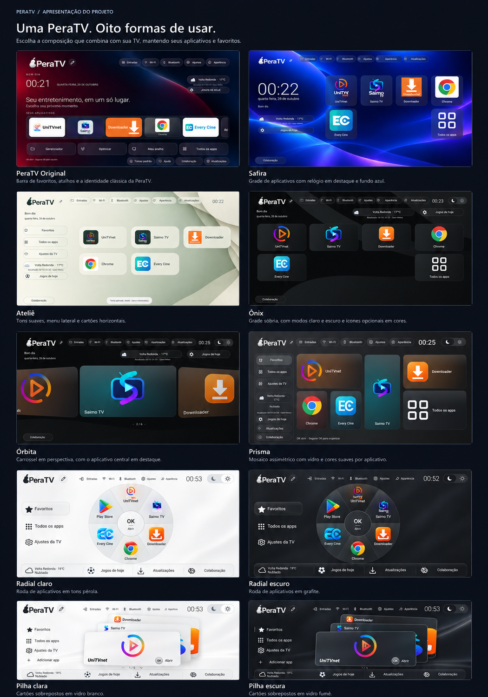
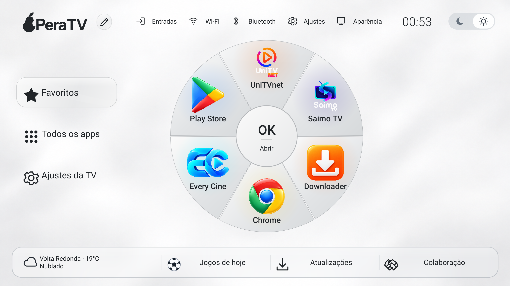
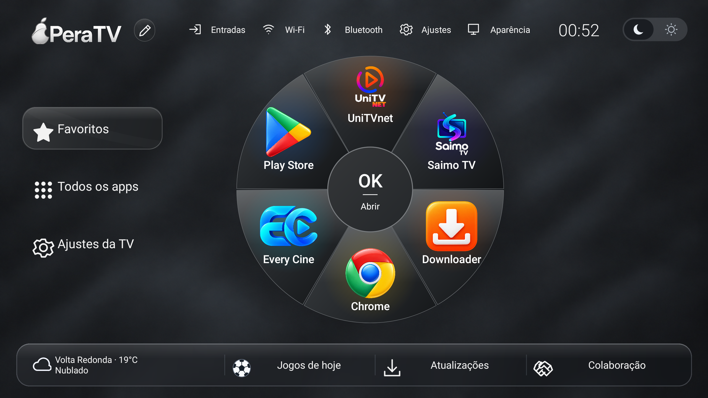
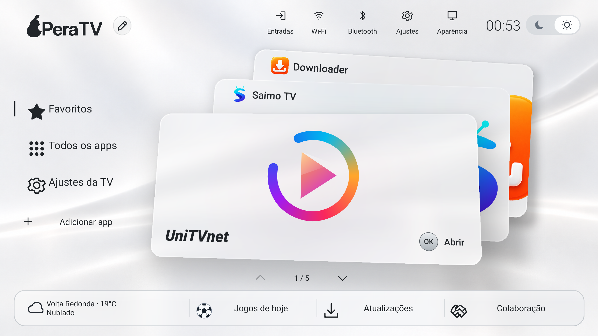
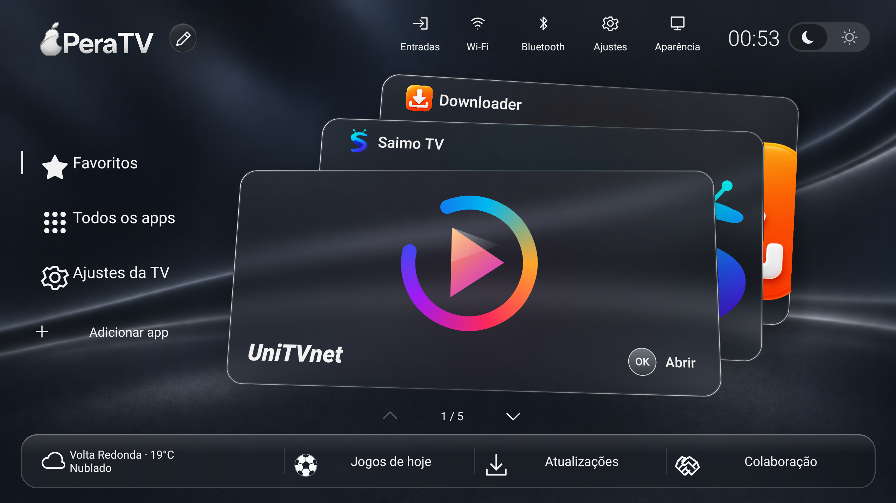
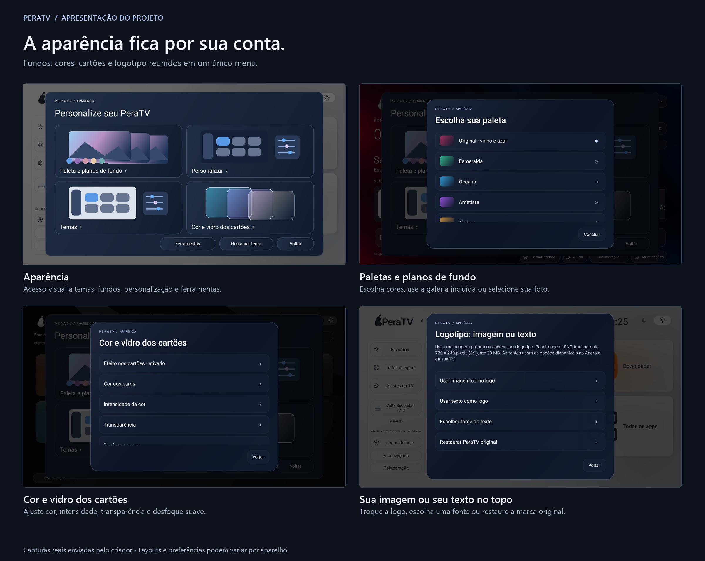
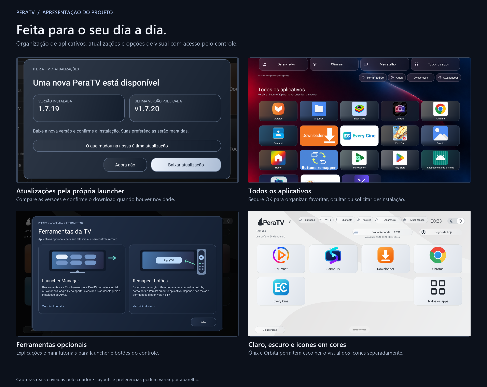

# PeraTV

**Baixar pelo Downloader:** digite o código **1710293**

**Sua TV, seus aplicativos, sua aparência.**

A PeraTV é uma launcher para Android TV, Google TV e TV boxes compatíveis. Ela organiza os aplicativos instalados em uma tela inicial personalizável, com navegação pelo controle remoto, temas diferentes e acesso rápido aos ajustes da TV.

O projeto foi criado por **Fernando** e vem sendo aprimorado a partir do uso e das sugestões recebidas. É um aplicativo de tela inicial: não substitui o Android nem instala uma nova ROM.

[Baixar a versão mais recente](https://github.com/PeraTV/peratv-atualizacoes/releases/latest)

## Oito temas no mesmo aplicativo

Cada tema tem sua própria composição. A troca preserva seus aplicativos e favoritos, sem exigir a instalação de outra launcher.

| Tema | Como é |
| --- | --- |
| **PeraTV Original** | Identidade clássica da PeraTV, favoritos em uma barra horizontal e atalhos de uso diário. |
| **Safira** | Fundo azul, grade de aplicativos e relógio em destaque na lateral. |
| **Ateliê** | Visual claro e minimalista, menu lateral e cartões horizontais organizados em colunas. |
| **Ônix** | Grade de cartões com aparência sóbria. Oferece modo claro ou escuro e ícones monocromáticos ou coloridos. |
| **Órbita** | Carrossel com cartões laterais inclinados e aplicativo central em destaque. Oferece modo claro ou escuro, escolha de ícones e opção de visual colorido. |
| **Radial** | Roda fixa de seis posições, com modos claro e escuro. Uma posição vazia permite adicionar um app; segure OK para trocar e organizar favoritos. |
| **Pilha** | Cartões sobrepostos com profundidade, versões clara e escura e transparência ajustável de 0 a 100%. |
| **Prisma** | Mosaico assimétrico com cartões de tamanhos diferentes, efeito de vidro e modos claro e escuro. A tela inicial exibe até cinco favoritos e o acesso a todos os apps. |

Para escolher, abra **Aparência → Temas**, veja a prévia e confirme em **Aplicar tema**. Nos temas compatíveis, o seletor de sol e lua alterna entre claro e escuro. A preferência permanece salva.

## Radial — claro e escuro

Capturas reais da launcher em execução. Os aplicativos mostrados dependem do que está instalado no aparelho.

| Claro | Escuro |
| --- | --- |
|  |  |

## Pilha — claro e escuro

| Claro | Escuro |
| --- | --- |
|  |  |

## Personalize do seu jeito

- **Paletas e fundos:** escolha uma paleta, um dos fundos da galeria ou uma imagem própria. O escurecimento ajuda a manter os textos legíveis.
- **Cartões:** ajuste a cor automática baseada no ícone, use uma cor neutra ou personalize por aplicativo. Há controles de intensidade da cor, transparência e desfoque.
- **Ícones:** use a identificação do aplicativo ou escolha um ícone personalizado. As opções de ícones em cores do Ônix e do Órbita são independentes do modo claro ou escuro.
- **Logotipo:** mantenha a PeraTV, coloque sua própria imagem ou use um texto com as fontes disponíveis no Android da TV.
- **Seleção do controle:** ajuste a borda de foco para reconhecer o aplicativo selecionado com mais facilidade.
- **Restaurar tema:** retorne às opções visuais padrão quando quiser desfazer personalizações. A ação pede confirmação e informa o alcance da restauração; aplicativos e favoritos são mantidos.

**Imagens recomendadas:** wallpaper em 1920 × 1080 pixels, proporção 16:9; logotipo em PNG transparente, 720 × 240 pixels, proporção 3:1. A launcher aceita imagens de até 20 MB. Fundos com outras proporções podem ser recortados para preencher a tela.

## Como usar pelo controle

Use as **setas** para navegar, **OK** para abrir e **Voltar** para retornar. Ao **segurar OK** em um aplicativo, aparecem as ações disponíveis naquele local.

Em **Todos os aplicativos**, é possível adicionar ou remover favoritos, trocar o ícone, mover, ocultar, criar ou adicionar a uma pasta, abrir as informações do app e solicitar sua desinstalação. A desinstalação depende da confirmação do Android; aplicativos de sistema podem ter restrições. Apps ocultos podem ser mostrados novamente em **Aparência → Personalizar → Aplicativos ocultos**.

A organização da lista de todos os apps é independente da ordem dos favoritos. Também existem opções de backup e restauração das configurações da launcher.

## Recursos do dia a dia

**Clima:** mostra a cidade escolhida, temperatura e condição disponíveis pela integração Open-Meteo. Precisa de conexão para consultar novos dados e informa quando eles foram atualizados.

**Jogos de hoje:** consulta partidas, horários, placares e escudos quando fornecidos pela fonte. Inclui classificação por competição, temporada e grupos quando disponível. A transmissão só é informada quando a fonte fornece esse dado; o canal não é garantido em todos os jogos. A navegação pelo controle permite avançar na grade sem selecionar a seta de página. A cobertura e os placares dependem da ESPN e podem sofrer atrasos. Esse painel consulta informações; não transmite as partidas.

**Atalhos da TV:** Entradas, Wi-Fi, Bluetooth e Ajustes abrem as opções disponíveis no aparelho. O funcionamento pode variar conforme o Android e o fabricante.

**Atualizações:** a PeraTV consulta novas versões sem exigir que você abra o botão. Quando encontra uma versão mais recente, exibe uma bolinha vermelha com o número 1. Ao abrir o painel, você compara a versão instalada com a publicada e decide se quer baixar. Após o download e a conferência de assinatura, o Android solicita a confirmação para instalar. As notas de “O que mudou na nossa última atualização” acompanham o APK e descrevem a versão instalada.

**Ferramentas:** o menu inclui explicações e mini tutoriais para Launcher Manager e remapeamento de botões. São aplicativos opcionais, instalados e configurados separadamente. O Launcher Manager pode ajudar quando a TV não mantém a PeraTV como tela inicial; ele não desbloqueia a instalação de APKs. A compatibilidade depende do aparelho e das permissões disponíveis.

**Colaboração:** Gostou da PeraTV? Faça uma doação pix e ajude a manter o projeto e suas próximas atualizações. Sua Contribuição faz a diferença!

O QR code está no botão **Colaboração**, dentro da launcher. A contribuição é voluntária.

O atalho **Otimizar**, nos temas em que aparece, abre o aplicativo escolhido pelo usuário. A PeraTV não promete limpar o cache ou liberar a memória de outros aplicativos por conta própria.

## Novidades recentes

- **Radial e Pilha:** dois layouts com versões clara e escura, integrados à seleção de temas.
- **Radial sem páginas:** seis posições na mesma roda. O aplicativo escolhido ocupa a posição vazia; segure OK para trocar ou organizar um favorito.
- **Pilha ajustável:** transparência de 0 a 100%, em passos de 1%, com preferência salva e logos e textos opacos.
- **Ícones:** novos recursos visuais para YouTube, Downloader, Every Cine, Chrome, Netflix, Spotify, Prime Video, HBO, Play Store e exploradores de arquivos no Radial e na Pilha. O pack permite escolher manualmente; outros aplicativos mantêm seus próprios recursos.
- **Futebol:** classificação por competição, temporada e grupos, com escudos e dados disponíveis na fonte.
- **Atualização dentro da launcher:** comparação entre versão instalada e publicada, download interno e confirmação de instalação pelo Android.
- **Aviso de atualização:** indicador vermelho com leitura ampliada no Radial e na Pilha, exibido apenas para uma versão mais recente.
- **Colaboração:** mensagem de apoio via Pix atualizada, mantendo o QR code.

Os temas Fluxo e Boreal foram retirados da seleção. As novidades acima são acumuladas de versões recentes, e não exclusivamente da 1.7.31. Os canais de transmissão dependem dos dados da fonte e ainda não estão disponíveis em todos os jogos.

## O que foi desenvolvido e aprimorado

A evolução do projeto reúne oito composições de tela, personalização de imagens e ícones, organização de aplicativos e integrações de clima, futebol e atualizações. As versões recentes receberam ajustes de contraste nos temas claros, alinhamento dos botões, retorno aos menus de aparência, restauração visual e indicação de atualização disponível.

O painel de download também ganhou apresentação própria e reaproveitamento de downloads concluídos após validação. A seção de colaboração passou a usar o QR code indicado pelo criador, acompanhado de uma mensagem de apoio. Esses são avanços acumulados do projeto; consulte as notas de cada versão na área de lançamentos.

## Instalação e compatibilidade

Baixe o APK na versão mais recente publicada. Para atualizar uma instalação compatível, instale por cima da versão anterior, mantendo o mesmo pacote e assinatura. O Android poderá solicitar autorização para instalar aplicativos dessa origem.

A seleção como tela inicial depende do sistema da TV. Antes de remover uma launcher que esteja definida como padrão, restaure uma tela inicial funcional. Os aplicativos mostrados nas capturas pertencem ao aparelho usado na demonstração; instalar a PeraTV não inclui esses serviços, conteúdos ou assinaturas.

O efeito de vidro combina transparências, degradês e desfoque conforme o recurso e o aparelho. Sua aparência e a fluidez podem variar com o hardware; não há promessa de desfoque de sistema idêntico em todas as TVs.

A galeria geral é uma montagem de apresentação editada com IA a partir das capturas enviadas; pequenos detalhes podem diferir. As quatro imagens individuais de Radial e Pilha, acima, são as capturas originais sem edição. As imagens de personalização e recursos reúnem capturas com títulos e legendas; as telas não foram redesenhadas. Algumas capturas registram mensagens temporárias de aplicação do tema. A captura do atualizador mostra uma instalação 1.7.19 encontrando a 1.7.20, como exemplo do fluxo de atualização.

**Feito por Fernando.**

**Se quiser Suporte ou quiser que faça ajustes de personalização etc. basta chamar no telegram @FernandoRGH**
